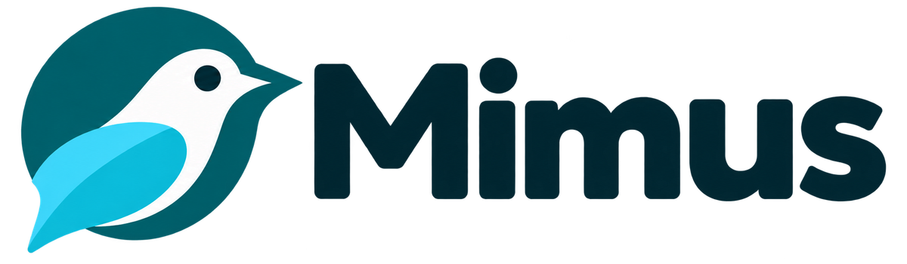
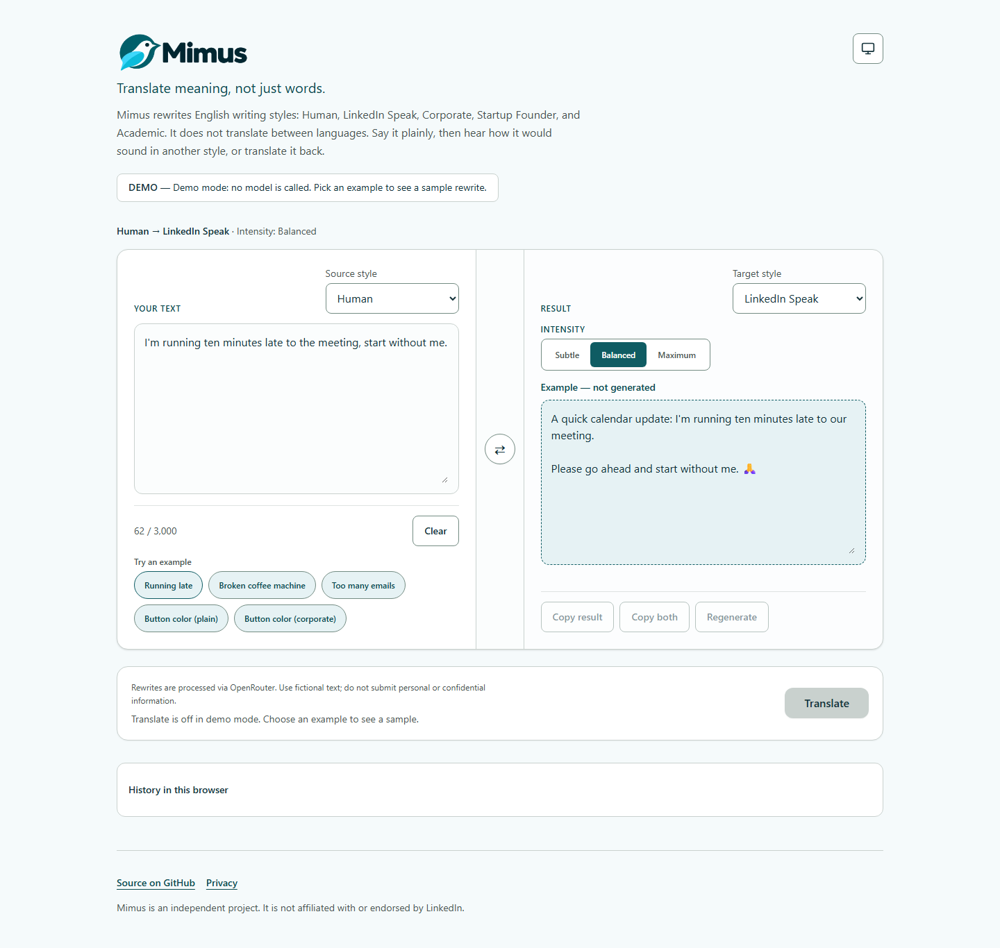
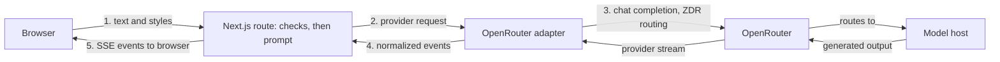

<h1 align="center">
  <picture>
    <source media="(prefers-color-scheme: dark)" srcset="docs/assets/mimus-logo-dark.png">
    
  </picture>
</h1>

<p align="center"><strong>Translate meaning, not just words.</strong></p>

Mimus rewrites English text between writing styles. Plain speech becomes LinkedIn
speak, corporate phrasing becomes ordinary language, and so on. It translates
register, not language, and it tries to change how something is said without
changing what it says.

For example (written by hand, not model output):

> **Human:** The team spent three hours discussing a button color.
>
> **LinkedIn, Maximum:** Three hours. One button color. That was the team's
> discussion. #Design #Collaboration

I built Mimus by working with AI coding agents. Together we shaped how the app
would work—from the architecture and privacy boundaries down to the evaluation
benchmarks. The agent turned those specs into code, and I guided the
implementation through manual reviews, accessibility audits, and iterative
improvements. The [design notes](docs/design-notes.md#ai-assisted-development)
cover the process, the decisions, and what fell short.

[**Try Mimus**](https://mimus-rewrite.vercel.app) ·
[Design notes](docs/design-notes.md) · [Product specification](docs/product-spec.md) ·
[Evaluation](evals/README.md)



<sub>Demo-mode screenshot. The result is a labeled, prewritten example, not live
model output.</sub>

## Features

- Five styles (Human, LinkedIn Speak, Corporate, Startup Founder, Academic), all 20
  directions between them, and three intensities (Subtle, Balanced, Maximum).
- Streamed output with Stop, Copy result, Copy both, Regenerate, and Swap. Your
  original input stays available, and stale results are labeled as such.
- A demo mode that needs no credentials, a mobile layout, a keyboard shortcut, and
  preferences stored only in your browser. Optional history (the last 10 completed
  results) is off by default and never leaves the browser.
- A data-use notice next to the Translate button and a `/privacy` page. There are no
  accounts, no application database, and no analytics.

## How it works



It's one Next.js deployment (App Router, TypeScript, Tailwind) with a single Node.js
route. That route validates the request before any model call, keeps trusted
instructions separate from the submitted text, and streams the result back as
server-sent events (SSE). The model, reasoning effort, output cap, and privacy
routing are committed together in
[`src/lib/server/model-config.ts`](src/lib/server/model-config.ts). They are not read
from the environment or the browser.

## Model and privacy

Live mode calls OpenRouter with `google/gemini-3.5-flash-lite` (minimal reasoning,
2,048-token output cap). Requests ask OpenRouter for zero-data-retention (ZDR)
routing and deny data collection. That is not a promise that nothing is stored:
Google may keep prompts and responses for safety monitoring, and flagged content may
be reviewed by people. Mimus has no database and doesn't intentionally save your text
on its servers, in logs, or in URLs, but you should use fictional text and nothing
personal or confidential.

The full notice and provider-policy links are on the
[`/privacy`](https://mimus-rewrite.vercel.app/privacy) page. The reasoning behind the
policy is in the [design notes](docs/design-notes.md#google-vertex-safety-retention).

## Evaluation

Meaning preservation is the hard part of this project, so the evaluations score
meaning and style separately and compare quality, latency, and cost across models.

In the [fresh release comparison](evals/results/release-run-2026-10-15.md), Gemini with
minimal reasoning scored 37/40 on full meaning and 37/40 on full style under an
automated rubric. Humans audited only 8 outputs, and just one of them was Gemini, so
that check is thin. Production also produced a numerical error (a 6% decrease became
"six percentage points") that I've accepted as a known limitation. Meaning
preservation is a goal, not a guarantee. The [evaluation guide](evals/README.md) has
the full results, failures, and earlier model history.

You can check the published comparison without a key or any provider requests:

```bash
npm run eval:verify
```

## Run locally

Requires Node.js 24 (see `.nvmrc`).

```bash
npm ci
npm run dev
```

With no configuration the app runs in demo mode. It shows examples, calls no model,
and needs no key. For live generation on your machine, copy
[`.env.example`](.env.example) to `.env.local`, add your own `OPENROUTER_API_KEY`,
and set `MIMUS_MODE=live` and `MIMUS_DEV_ALLOW_LOCAL_LIVE=true` (loopback
development only). Live requests cost money on your OpenRouter account.

To run the full checks:

```bash
npm run format:check && npm run lint && npm run typecheck && npm test
npm run eval:verify && npm run build
npx playwright install chromium
npm run test:e2e   # Playwright, mocked browser/API; no provider calls
```

On Linux, use `npx playwright install --with-deps chromium` to install the
browser's system dependencies too. Stop the development server before running the
browser tests, because Playwright starts its own demo and mocked-live servers.

`npm run format` formats source, tests, scripts, and active configuration. Frozen
evaluation data and published records are excluded.

## Documentation

- [Product specification](docs/product-spec.md): what the app is meant to do.
- [Design notes](docs/design-notes.md): design, evaluation, and lessons learned.
- [Deployment and operations](docs/deployment.md): configuration, activation,
  shutdown, and rollback.
- [Decisions and evidence](docs/decisions.md) and [CHANGELOG](CHANGELOG.md).
- [Release checklist](docs/release-checklist.md): what's verified and what's still
  open.
- [Repository instructions](AGENTS.md): conventions for working in the repo.

## License

[MIT](LICENSE). Mimus is an independent project, not affiliated with or endorsed by
LinkedIn. Third-party services have their own terms.
