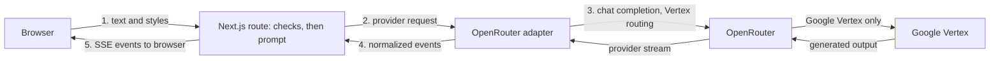

<h1 align="center">
  <picture>
    <source media="(prefers-color-scheme: dark)" srcset="docs/assets/mimus-logo-dark.png">
    
  </picture>
</h1>

<p align="center"><strong>Translate meaning, not just words.</strong></p>

Mimus is a small personal project for learning and experimenting with AI-assisted
software development and text rewriting. It rewrites English text between
recognizable writing styles: plain English into LinkedIn speak, corporate phrasing
back into ordinary language, and more. It is a rewrite between writing registers,
not a translator between languages, and it aims to change the expression without
inventing facts or losing the point.

[**Try Mimus**](https://mimus-rewrite.vercel.app) ·
[Design notes](docs/case-study.md) · [Product specification](docs/product-spec.md) ·
[Evaluation](evals/README.md)


<sub>Demo-mode screenshot: the result is a labeled, prewritten example, not live
model output.</sub>

## Features

- Five styles (Human, LinkedIn, Corporate, Startup Founder, Academic), all 20
  directions, and three intensities (Subtle, Balanced, Maximum).
- Streamed output with Stop, Copy result, Copy both, Regenerate, and Swap. The
  original input stays available and stale results are labeled.
- A credential-free demo mode, mobile layout, keyboard shortcut, and local-only
  preferences. Optional history of up to 10 completed results is off by default and
  stays in the browser.
- Data-use notice next to Translate, a `/privacy` page, and no accounts, application
  database, or analytics.

## How it works



One Next.js (App Router, TypeScript, Tailwind) deployment with a single Node.js
route. Trusted instructions and submitted text are kept separate, validation runs
before any model call, and the model, reasoning effort, output cap, and privacy
routing are committed together in
[`src/lib/server/model-config.ts`](src/lib/server/model-config.ts), not read from
the environment or the browser.

## Model and privacy

Live mode calls OpenRouter with `google/gemini-3.5-flash-lite` (minimal reasoning,
prompt v4, 2,048-token output cap) and restricts routing to Google Vertex. It
retains OpenRouter's `data_collection: "deny"` routing preference, separately
from Google's safety-retention policy, and does not require zero-data-retention
routing.
The choice and its trade-offs are explained in the [design notes](docs/case-study.md).

Live text is sent to OpenRouter and Google Vertex. Google's [data governance](https://docs.cloud.google.com/gemini-enterprise-agent-platform/resources/zero-data-retention)
and [abuse monitoring](https://docs.cloud.google.com/gemini-enterprise-agent-platform/models/abuse-monitoring)
policies describe safety retention and possible human review of flagged content.
Under applicable policies, content is not used to train or fine-tune models without
permission or instruction. Provider caching may occur; Mimus does not promise a
specific retention period. The OpenRouter preference does not itself mean the host
stores no data. Mimus does not intentionally store text on its
application servers, in its logs, or in URLs. Use fictional text and do not submit
personal or confidential information.
The full notice is on the [`/privacy`](https://mimus-rewrite.vercel.app/privacy) page.

## Design and evaluation

The server handles validation, streaming, cancellation, and incomplete results.
The evaluations measure meaning and style separately and compare quality,
latency, and cost. The [design notes](docs/case-study.md) link the implementation,
tests, dated results, and remaining limitations.

The [fresh release comparison](evals/results/release-run-2026-10-15.md)
recommended Gemini minimal: it scored 37/40 for full meaning and 37/40 for full
style under the frozen automated rubric. Human auditing was limited and uneven:
only one of eight audited outputs was Gemini. Production also produced a numerical
meaning error that remains an accepted limitation. Meaning preservation is a goal,
not a guarantee; the [evaluation guide](evals/README.md) retains results, failures,
and earlier model history.

You can check the published comparison without a key or provider requests:

```bash
npm run eval:verify
```

AI coding agents contributed substantially to planning, implementation, testing,
and review. I set product priorities, approved major decisions, completed blind
reviews, and performed manual UI checks. The [AI-assisted development account](docs/case-study.md#ai-assisted-development)
describes those contributions and their limits.

## Run locally

Requires Node.js 24 (see `.nvmrc`).

```bash
npm ci
npm run dev
```

With no configuration the app runs in demo mode: examples are shown, no model is
called, and no key is needed. For live generation on your machine, copy
[`.env.example`](.env.example) to `.env.local`, add your own `OPENROUTER_API_KEY`,
and set `MIMUS_MODE=live` and `MIMUS_DEV_ALLOW_LOCAL_LIVE=true` (loopback
development only). Live requests cost money on your OpenRouter account.

```bash
npm run format:check && npm run lint && npm run typecheck && npm test
npm run eval:verify && npm run build
npx playwright install chromium
npm run test:e2e   # Playwright, mocked browser/API; no provider calls
```

On Linux, use `npx playwright install --with-deps chromium` to install the
browser's system dependencies as well. Stop the development server before running
browser tests so Playwright starts its own configured demo and mocked-live servers.

Use `npm run format` to format source, tests, scripts, and active configuration.
Frozen evaluation data and published records are excluded.

## Documentation

- [Product specification](docs/product-spec.md): the behavioral contract.
- [Design notes](docs/case-study.md): design, evaluation, and lessons.
- [Deployment and operations](docs/deployment.md): configuration, activation,
  shutdown, and rollback.
- [Decisions and evidence](docs/decisions.md) and [CHANGELOG](CHANGELOG.md).
- [Release checklist](docs/release-checklist.md): completed verification, remaining
  evidence gaps, and publication decisions.
- [Repository instructions](AGENTS.md): development conventions.

## License

[MIT](LICENSE). Mimus is an independent project, not affiliated with or endorsed by
LinkedIn. Third-party services have their own terms.
