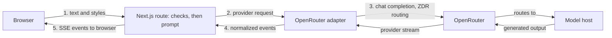

<h1 align="center">
  <picture>
    <source media="(prefers-color-scheme: dark)" srcset="docs/assets/mimus-logo-dark.png">
    
  </picture>
</h1>

<p align="center"><strong>Translate meaning, not just words.</strong></p>

Mimus rewrites English text between recognizable writing styles: plain English
into LinkedIn speak, corporate phrasing back into ordinary language, and more. It
is a rewrite between writing registers, not a translator between languages, and it
aims to change the expression without inventing facts or losing the point.

[**Try Mimus**](https://mimus-rewrite.vercel.app) ·
[Case study](docs/case-study.md) · [Product specification](docs/product-spec.md) ·
[Evaluation](evals/README.md)


<sub>Demo-mode screenshot: the result is a labeled, prewritten example, not live
model output.</sub>

## Status

**v1.0.0 is prepared and awaiting final approval.** No release or tag exists yet.

- **Live rewriting is on at the Production site.** It uses `z-ai/glm-5.3-flash`
  through OpenRouter, for visitors in approved regions after they acknowledge the
  data-use notice. The owner observed a successful Human to Corporate rewrite that
  kept the meeting-reschedule facts, and real streaming in Chrome DevTools (a `meta`
  event, 13 `delta` events, and `done` in about 724 ms). Very short responses can
  look like they arrive at once.
- **Quality is accepted with limits, not proven.** The owner chose to ship GLM with
  documented quality limitations for a free, experimental portfolio app. The
  original meaning-preservation target was not demonstrated, and formal GLM scores
  were not committed. See [Evaluation](#evaluation).
- **Spend controls are owner-confirmed, not independently verified:** a $1/month
  Production key limit, with auto-recharge disabled, and ZDR and privacy settings
  applied. A monthly limit caps spending within its monthly period, not lifetime
  spend, and it does not guarantee zero additional charges. The service can stop at
  any time.
- **Without a key, the app runs in demo mode:** prewritten, labeled examples and no
  model calls. You can also run live mode locally with your own OpenRouter key.
- **Known limits:** emergency shutdown has not been rehearsed end to end, and it is
  not verified whether a Stop reaches the model host and stops billing. See
  [`docs/deployment.md`](docs/deployment.md) and the [changelog](CHANGELOG.md).

## Features

- Five styles (Human, LinkedIn, Corporate, Startup Founder, Academic), all 20
  directions, and three intensities (Subtle, Balanced, Maximum).
- Streamed output with Stop, Copy result, Copy both, Regenerate, and Swap. The
  original input stays available and stale results are labeled.
- A credential-free demo mode, mobile layout, keyboard shortcut, and local-only
  preferences. Optional history of up to 10 completed results is off by default and
  stays in the browser.
- Data-use notice next to Translate, a `/privacy` page, and no accounts, application
  database, or analytics.

## How it works



One Next.js (App Router, TypeScript, Tailwind) deployment with a single Node.js
route. Trusted instructions and submitted text are kept separate, validation runs
before any model call, and the model, reasoning effort, output cap, and privacy
routing are committed together in
[`src/lib/server/model-config.ts`](src/lib/server/model-config.ts), not read from
the environment or the browser.

## Model and privacy

Live mode calls OpenRouter with `z-ai/glm-5.3-flash` (low reasoning, 2,048-token
output cap) and requests zero-data-retention endpoints with data collection
denied. Hosts are not pinned, so behavior can vary between requests. The choice
and its trade-offs are explained in the [case study](docs/case-study.md).

Live text is sent to OpenRouter and then to a third-party model host. Mimus has no
application database and does not intentionally persist submitted or generated text
on its servers, in logs, or in URLs. Zero data retention is an endpoint routing
policy, not anonymity: the hosting platform and OpenRouter still process request
metadata, and a host may cache prompts in memory. Use fictional text. The full notice
is on the [`/privacy`](https://mimus-rewrite.vercel.app/privacy) page.

## Evaluation

Quality is measured on 50 synthetic cases with deterministic checks and manual
meaning and style scoring.

- The **Gemini** release-candidate evaluation was formally scored. It is historical
  evidence for a previous provider and does not apply to GLM:
  [`evals/results/summary.md`](evals/results/summary.md).
- The **GLM** development run completed 40 of 40 requests, and 39 of 40 passed the
  deterministic checks. Formal meaning and style scores were not committed, and the
  original meaning target was not demonstrated:
  [`evals/results/glm-development.md`](evals/results/glm-development.md).
- For v1.0.0 the owner revised the release evidence requirement and accepted these
  limitations instead of requiring another 50-case run. GLM is not claimed to have
  passed the original benchmark or to preserve meaning better than Gemini. The
  pre-registered GLM evaluation is deferred, not completed; see
  [`docs/decisions.md`](docs/decisions.md#2026-10-14-v100-release-decision-and-production-activation-active).

Meaning preservation is a goal, not a guarantee for any individual result.

## Run locally

Requires Node.js 24 (see `.nvmrc`).

```bash
npm ci
npm run dev
```

With no configuration the app runs in demo mode: examples are shown, no model is
called, and no key is needed. For live generation on your machine, copy
[`.env.example`](.env.example) to `.env.local`, add your own `OPENROUTER_API_KEY`,
and set `MIMUS_MODE=live` and `MIMUS_DEV_ALLOW_LOCAL_LIVE=true` (loopback
development only). Live requests cost money on your OpenRouter account.

```bash
npm run lint && npm run typecheck && npm test && npm run build
npm run test:e2e   # Playwright, mocked provider
```

## Documentation

- [Product specification](docs/product-spec.md): the behavioral contract.
- [Case study](docs/case-study.md): design, evaluation, and lessons.
- [Deployment and operations](docs/deployment.md): configuration, activation,
  shutdown, and rollback.
- [Decisions and evidence](docs/decisions.md) and [CHANGELOG](CHANGELOG.md).
- [Repository instructions](AGENTS.md): development conventions.

## License

[MIT](LICENSE). Mimus is an independent project, not affiliated with or endorsed by
LinkedIn. Third-party services have their own terms.
