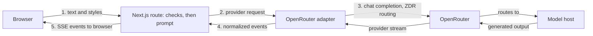

<h1 align="center">
  <picture>
    <source media="(prefers-color-scheme: dark)" srcset="docs/assets/mimus-logo-dark.png">
    
  </picture>
</h1>

<p align="center"><strong>Translate meaning, not just words.</strong></p>

Mimus is a small personal project that rewrites English text between recognizable
writing styles: plain English
into LinkedIn speak, corporate phrasing back into ordinary language, and more. It
is a rewrite between writing registers, not a translator between languages, and it
aims to change the expression without inventing facts or losing the point.

[**Try Mimus**](https://mimus-rewrite.vercel.app) ·
[Design notes](docs/case-study.md) · [Product specification](docs/product-spec.md) ·
[Evaluation](evals/README.md)


<sub>Demo-mode screenshot: the result is a labeled, prewritten example, not live
model output.</sub>

## Features

- Five styles (Human, LinkedIn, Corporate, Startup Founder, Academic), all 20
  directions, and three intensities (Subtle, Balanced, Maximum).
- Streamed output with Stop, Copy result, Copy both, Regenerate, and Swap. The
  original input stays available and stale results are labeled.
- A credential-free demo mode, mobile layout, keyboard shortcut, and local-only
  preferences. Optional history of up to 10 completed results is off by default and
  stays in the browser.
- Data-use notice next to Translate, a `/privacy` page, and no accounts, application
  database, or analytics.

## How it works



One Next.js (App Router, TypeScript, Tailwind) deployment with a single Node.js
route. Trusted instructions and submitted text are kept separate, validation runs
before any model call, and the model, reasoning effort, output cap, and privacy
routing are committed together in
[`src/lib/server/model-config.ts`](src/lib/server/model-config.ts), not read from
the environment or the browser.

## Model and privacy

Live mode calls OpenRouter with `google/gemini-3.5-flash-lite` (minimal reasoning, 2,048-token
output cap) and requests zero-data-retention endpoints with data collection
denied. Hosts are not pinned, so behavior can vary between requests. The choice
and its trade-offs are explained in the [design notes](docs/case-study.md).

Live text is sent to OpenRouter and then to a third-party model host. Mimus has no
application database and does not intentionally persist submitted or generated text
on its servers, in logs, or in URLs. Zero data retention is an endpoint routing
policy, not anonymity: the hosting platform and OpenRouter still process request
metadata, and a host may cache prompts in memory. Use fictional text. The full notice
is on the [`/privacy`](https://mimus-rewrite.vercel.app/privacy) page.

## Design and evaluation

The server handles validation, streaming, cancellation, and incomplete results.
The evaluations measure meaning and style separately and compare quality,
latency, and cost. The [design notes](docs/case-study.md) link the implementation,
tests, dated results, and remaining limitations.

The historical corpus contains 50 synthetic cases. The new benchmark adds a
12-case screening list, a 40-output evaluator challenge set, and 40 fresh release
cases. Its protocol compares reasoning settings across four generators, studies
LLM and decision-model scoring, and simulates a review cascade offline. Human
review is limited to calibration and a small audit. The benchmark and data are
described in [the protocol](docs/benchmark-protocol.md) and
[evaluation guide](evals/README.md).

The [fresh release comparison](evals/results/release-run-2026-10-15.md) recommends
Gemini minimal: it met the frozen automated targets with 37/40 full-meaning and
37/40 full-style scores. Haiku low scored 38/40 and 23/40, with one unresolved
judgment. Eight blind human audits agreed with the judge on meaning in 7/8 and
style in 4/8; only one audited output was Gemini. These are automated results with
limited human auditing, not independently validated accuracy. The committed runtime
configuration adopts Gemini minimal and is deployed on Production. Streaming and
metadata-only logs were verified; a numerical meaning defect is retained as an
accepted limitation (see the [adoption decision](docs/decisions.md#2026-10-16-gemini-minimal-adoption-production-verified)).
The older **Gemini** release-candidate evaluation remains historical evidence for
that configuration only ([summary](evals/results/summary.md)). The **GLM** run
completed 40 requests and 39 passed deterministic checks, but has no committed
formal meaning/style scores ([record](evals/results/glm-development.md)).
Meaning preservation remains a goal, not a guarantee for any individual result.

## Run locally

Requires Node.js 24 (see `.nvmrc`).

```bash
npm ci
npm run dev
```

With no configuration the app runs in demo mode: examples are shown, no model is
called, and no key is needed. For live generation on your machine, copy
[`.env.example`](.env.example) to `.env.local`, add your own `OPENROUTER_API_KEY`,
and set `MIMUS_MODE=live` and `MIMUS_DEV_ALLOW_LOCAL_LIVE=true` (loopback
development only). Live requests cost money on your OpenRouter account.

```bash
npm run lint && npm run typecheck && npm test && npm run build
npm run test:e2e   # Playwright, mocked provider
```

## Documentation

- [Product specification](docs/product-spec.md): the behavioral contract.
- [Design notes](docs/case-study.md): design, evaluation, and lessons.
- [Deployment and operations](docs/deployment.md): configuration, activation,
  shutdown, and rollback.
- [Decisions and evidence](docs/decisions.md) and [CHANGELOG](CHANGELOG.md).
- [Release checklist](docs/release-checklist.md): completed verification, remaining
  evidence gaps, and publication decisions.
- [Repository instructions](AGENTS.md): development conventions.

## License

[MIT](LICENSE). Mimus is an independent project, not affiliated with or endorsed by
LinkedIn. Third-party services have their own terms.
