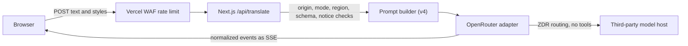

# Mimus

**Translate meaning, not just words.**

Mimus rewrites English text between recognizable writing styles: plain English
into LinkedIn speak, corporate phrasing back into ordinary language, and more. It
is a rewrite between writing registers, not a translator between languages, and it
aims to change the expression without inventing facts or losing the point.

[**Try the examples**](https://mimus-rewrite.vercel.app) ·
[Case study](docs/case-study.md) · [Product specification](docs/product-spec.md) ·
[Evaluation](evals/README.md)


## Status

Mimus is being prepared for its first release, **v1.0.0**. No release or tag
exists yet.

- **The public site is examples-only.** It shows prewritten, labeled examples and
  makes no model calls.
- **Live generation is implemented and has been verified on a protected
  preview** (streaming, privacy acknowledgement, origin check, an allowed-region
  request, logs without text), but it is not enabled publicly. Enabling it depends on owner
  decisions about provider policy, spend controls, and quality acceptance. You can
  run it locally with your own OpenRouter key.
- **Quality acceptance for the current model is open.** The earlier Gemini
  evaluation does not transfer, and the GLM development run did not meet the
  original meaning target. See [Evaluation](#evaluation).

## Features

- Five styles (Human, LinkedIn, Corporate, Startup Founder, Academic), all 20
  directions, and three intensities (Subtle, Balanced, Maximum).
- Streamed output with Stop, Copy result, Copy both, Regenerate, and Swap. The
  original input stays available and stale results are labeled.
- A credential-free demo mode, mobile layout, keyboard shortcut, and local-only
  preferences. Optional history of up to 10 completed results is off by default and
  stays in the browser.
- Data-use notice next to Translate, a `/privacy` page, and no accounts, database,
  or analytics.

## How it works



One Next.js (App Router, TypeScript, Tailwind) deployment with a single Node.js
route. Trusted instructions and submitted text are kept separate, validation runs
before any model call, and the model, reasoning effort, output cap, and privacy
routing are committed together in
[`src/lib/server/model-config.ts`](src/lib/server/model-config.ts), not read from
the environment or the browser.

## Model and privacy

Live mode calls OpenRouter with `z-ai/glm-5.3-flash` (low reasoning, 2,048-token
output cap) and requests zero-data-retention endpoints with data collection
denied. Hosts are not pinned, so behavior can vary between requests. The choice
and its trade-offs are explained in the [case study](docs/case-study.md).

Live text is sent to OpenRouter and then to a third-party host. Zero data
retention is an endpoint routing policy, not anonymity: OpenRouter still records
request metadata and a host may cache prompts in memory. Mimus does not store
submitted or generated text on its servers or in its logs. Use fictional text. The
full notice is on the [`/privacy`](https://mimus-rewrite.vercel.app/privacy) page.

## Evaluation

Quality is measured on 50 synthetic cases with deterministic checks and manual
meaning and style scoring.

- The **Gemini** release-candidate evaluation is complete and historical:
  [`evals/results/summary.md`](evals/results/summary.md).
- The **GLM** development run completed 40 of 40 requests but recorded no scores and
  did not meet the original meaning target:
  [`evals/results/glm-development.md`](evals/results/glm-development.md).
- A GLM release evaluation is defined but not run; see
  [`docs/decisions.md`](docs/decisions.md#glm-quality-gate-active).

Meaning preservation is a goal, not a guarantee for any individual result.

## Run locally

Requires Node.js 24 (see `.nvmrc`).

```bash
npm ci
npm run dev
```

With no configuration the app runs in demo mode: examples are shown, no model is
called, and no key is needed. For live generation on your machine, copy
[`.env.example`](.env.example) to `.env.local`, add your own `OPENROUTER_API_KEY`,
and set `MIMUS_MODE=live` and `MIMUS_DEV_ALLOW_LOCAL_LIVE=true` (loopback
development only). Live requests cost money on your OpenRouter account.

```bash
npm run lint && npm run typecheck && npm test && npm run build
npm run test:e2e   # Playwright, mocked provider
```

## Documentation

- [Product specification](docs/product-spec.md): the behavioral contract.
- [Case study](docs/case-study.md): design, evaluation, and lessons.
- [Deployment and operations](docs/deployment.md): configuration, activation,
  shutdown, and rollback.
- [Decisions and evidence](docs/decisions.md) and [CHANGELOG](CHANGELOG.md).
- [Repository instructions](AGENTS.md): development conventions.

## License

[MIT](LICENSE). Mimus is an independent project, not affiliated with or endorsed by
LinkedIn. Third-party services have their own terms.
